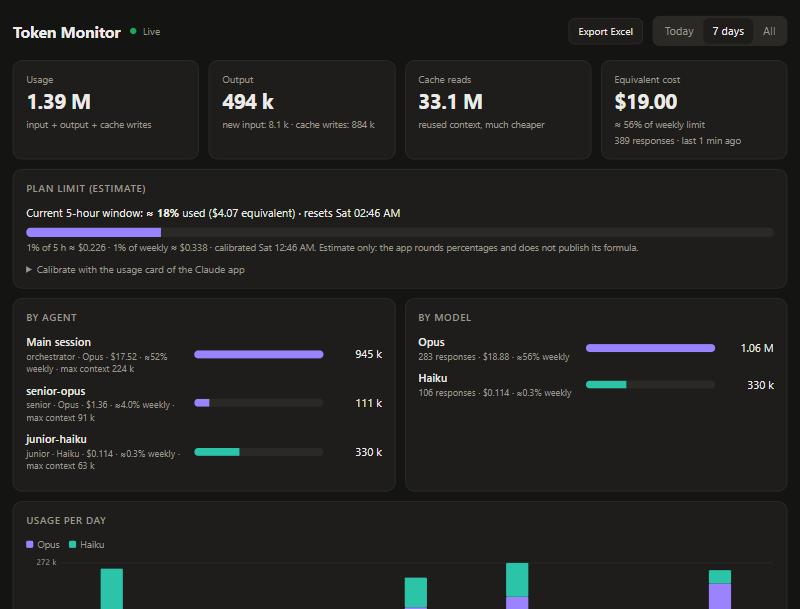

# claude-orchestra

**A cheaper way to work with Claude Code: Haiku does the legwork, Opus does the thinking, and a local dashboard shows what each one costs.**

[](../../actions/workflows/ci.yml)



<sub>Screenshot generated from fictional demo data.</sub>

> **🇪🇸 Resumen en español** — Un flujo de trabajo para Claude Code con dos subagentes: **Haiku** (junior) hace las preguntas iniciales, los borradores, la ejecución, los retoques y git; **Opus** (director) construye, piensa a fondo y revisa. Incluye un **monitor de tokens local** que muestra en tiempo real cuánto consume cada agente, su coste equivalente y el % estimado de tu límite, además de un Excel de seguimiento diario y semanal. Todo se ejecuta en tu equipo: tus conversaciones nunca salen de él. Se instala con `install.sh` / `install.ps1`, y el monitor se puede arrancar con Node o en un contenedor Docker endurecido.

## What's inside

| Part | What it does |
|---|---|
| [`skills/orchestra`](skills/orchestra/SKILL.md) | A Claude Code skill that splits every build task into **kick-off** (Haiku asks questions, writes `DRAFT.md`) → **build** (Opus) → **finish** (Haiku runs, fixes trivia, commits) → **review** (Opus). Includes rules to keep Haiku under its 100k pricing tier, use prompt caching well, and clean up context between tasks. |
| [`agents/junior-haiku.md`](agents/junior-haiku.md) | Haiku subagent at medium effort with a minimal tool set. |
| [`agents/senior-opus.md`](agents/senior-opus.md) | Opus subagent at high effort for hard, isolated problems. |
| [`token-monitor/`](token-monitor) | Zero-dependency Node dashboard that reads Claude Code transcripts live: tokens, equivalent API cost and estimated plan-limit share per agent, model and session; flags Haiku calls over 100k; exports an Excel workbook with daily and weekly summaries. |

### Why

Haiku is around 40× cheaper per token than Opus, but only if each call stays small. Letting Haiku read files, run commands and write first drafts, while Opus only builds and decides, keeps the expensive model's context clean and its bill low. The monitor lets you check whether that is actually happening.

## Install the skill and agents

```bash
git clone https://github.com/<you>/claude-orchestra && cd claude-orchestra
./install.sh            # or on Windows: .\install.ps1
```

Files go to `~/.claude/skills/orchestra` and `~/.claude/agents/`. Existing files are never overwritten unless you pass `--force` / `-Force`; `--dry-run` / `-DryRun` shows what would happen. Start a new Claude Code session afterwards and say *"use the orchestra"*, or just start a build task.

## Run the token monitor

### With Node (simplest)

Requires Node.js 18+. Python 3 with `openpyxl` is only needed for the Excel export.

```bash
cd token-monitor
node server.js          # http://127.0.0.1:4317
```

### With Docker (isolated)

```bash
cd token-monitor
cp .env.example .env    # set CLAUDE_PROJECTS_DIR to your ~/.claude/projects folder
docker compose up -d    # http://127.0.0.1:4317
```

The container is hardened by default:

- runs as a **non-root** user with a **read-only** root filesystem, `cap_drop: ALL` and `no-new-privileges`;
- transcripts are mounted **read-only** and never copied into the image;
- the port is published on **127.0.0.1 only**; the server also rejects any request whose `Host` header is not localhost (DNS-rebinding protection) and every state-changing call needs a custom header (CSRF protection);
- strict security headers (CSP, `X-Frame-Options: DENY`, no CORS), memory and process limits.

CI builds the image and checks all of the above on every push.

### Try it with fake data

```bash
cd token-monitor
node demo/generate.js /tmp/claude-demo
TOKEN_MONITOR_ROOT=/tmp/claude-demo node server.js
```

### Configuration

| Variable | Default | Meaning |
|---|---|---|
| `TOKEN_MONITOR_ROOT` | `~/.claude/projects` | Folder with Claude Code transcripts |
| `HOST` / `PORT` | `127.0.0.1` / `4317` | Listen address |
| `TOKEN_MONITOR_DATA` | `~/.claude/token-monitor-data` | Where the plan-limit calibration is stored |
| `TOKEN_MONITOR_OUT` | `./out` | Where Excel exports are written |
| `TOKEN_MONITOR_ALLOWED_HOSTS` | – | Extra host names to accept (comma-separated) |

### Plan-limit estimate

Claude subscription limits are not published as token counts. Open **"Calibrate"** in the dashboard and type the percentages shown on the Claude app's usage card: the monitor works out how much equivalent spend 1% represents and from then on shows every agent and session as a share of your 5-hour and weekly limits. It is an estimate; recalibrate after each reset.

### Prices

Costs use API list prices from [`token-monitor/pricing.json`](token-monitor/pricing.json), including cache-write multipliers and Haiku's 5× tier above 100k tokens per call. Prices change: check them and update the file.

## Privacy

- Everything runs locally; no telemetry, no network calls.
- The server only returns aggregated numbers; prompt and response text is never sent to the browser.
- Session titles and project folder names from your own machine are shown in **your** dashboard only. Nothing from your transcripts is part of this repository; the screenshot uses generated demo data.

## Development

```bash
node --test token-monitor/test/                 # unit + HTTP security tests
python token-monitor/export_excel.py out.xlsx   # needs: pip install openpyxl
```

## License

[MIT](LICENSE)
